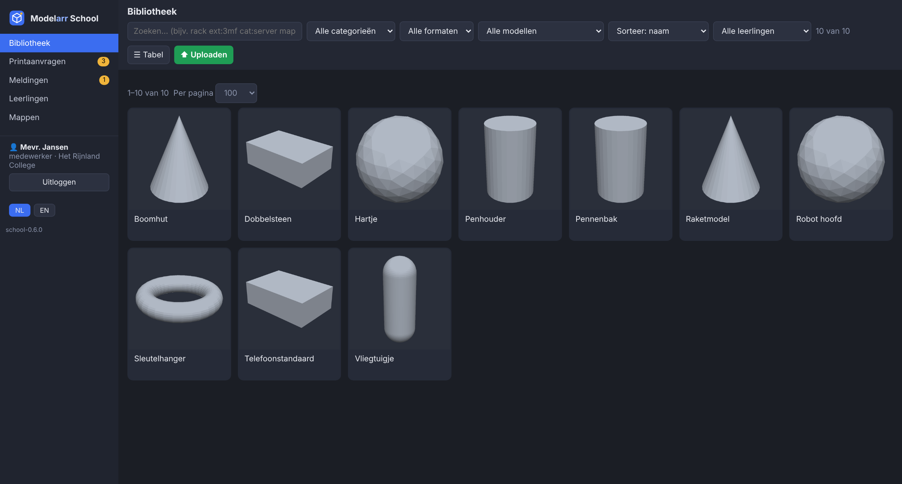
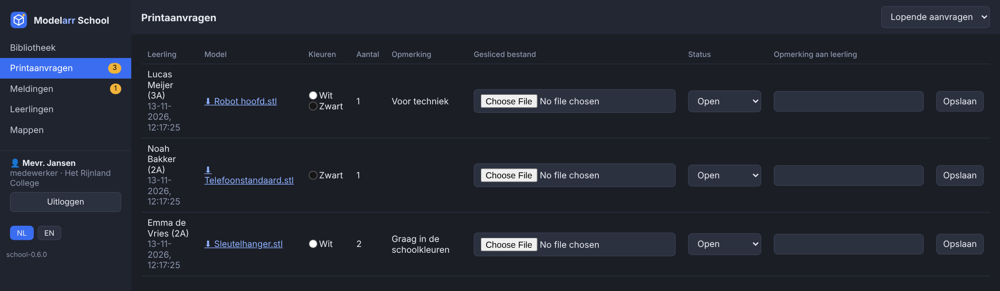
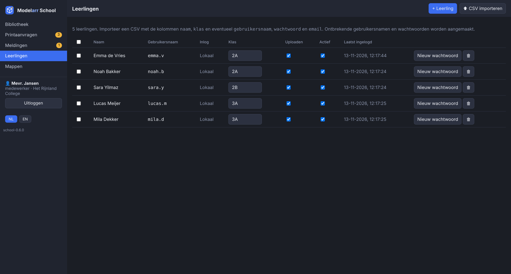

# Modelarr School (working title)

> Dutch version: [README-School-NL.md](README-School-NL.md)

A separate version of [Modelarr](README.md) for schools: students and staff keep and share their 3D models in one library, and students can ask a staff member to print something for them. One installation can serve several schools.

> This app was built with the help of [Claude](https://claude.ai/) (Anthropic). This is a first version.
>
> Version numbers follow Modelarr: *school-1.6.0* is the school version of Modelarr 1.6.0 (releases on GitHub are tagged `v1.6.0`). The Apps page of [PVE Fleet](https://github.com/romio23/PVE-fleet) can fetch the latest release by itself (`pvefleet-app.json`).

## Screenshots

Sample data with made-up schools and students.

**Library (staff member)**



**Print requests from students**



**Managing students**



## Roles

| Role | What it can do |
|---|---|
| **Administrator** | Everything: schools, staff, settings, all models |
| **Staff** | Sees all models of their own school and the general library, can hide folders of the general library, manages the students of their own school (create, CSV import, new password, deactivate), handles reports and print requests |
| **Student** | Sees their own models and everything that is shared (also from other schools), uploads to their own folder, can turn sharing on or off, report a model and request a print |

## Storage

All schools share one root folder. There is a folder per school and per user:

```
<root>/<school>/leerlingen/<student>/…
<root>/<school>/medewerkers/<staff member>/…
<root>/<school>/…                          (shared school library)
<root>/<other folder>/…                    (general library: visible to all students)
<root>/<school>/.aanvragen/<id>/…          (sliced file of a print request, hidden)
```

The folder names `leerlingen` (students) and `medewerkers` (staff) are fixed by the app.

Models outside the school folders form the **general library**: they are visible to everyone. A staff member or administrator can hide a folder (with everything in it) from students under **Folders**. The owner of a model in a school folder follows from the folder it is in. Sharing on or off is only a checkmark in the database: no files are moved. Whether a new model from a student is shared by default is set here:

- **Settings → General → Student uploads**: the general choice, on by default.
- **Settings → Schools → Share uploads**: per school *General* (follows the general choice), *On by default* or *Off by default*.

A student can choose to share when uploading and can still turn it on or off per model. The setting also applies to files that are put straight into a student's folder, for example through the share. Existing models do not change when you change the setting. Models from staff are shared by default.

## Installing

The same as Modelarr (see [README.md](README.md)). Then:

1. Under **Settings → Media management**, add the shared root folder and turn on *move/delete* (needed to be able to delete your own models).
2. Under **Settings → Schools**, create a school for each school, choose the root folder and, if you like, your own limit per student (MB).
3. Under **Settings → Users**, create the staff accounts (role *Staff*, choose the school).
4. Staff create students themselves under **Students**, one by one or with a CSV file.

Is the root folder on a NAS share? Then also follow "Share after a restart" in [README.md](README.md). If the share cannot be reached or is unexpectedly empty, the administrator sees a red bar with the path at the top. Students and staff only see a general message, without server paths. Nothing is removed from the library in that case.

### Importing students from a CSV file

The first line holds the column names (`;` or `,`): `naam` (name), `klas` (class), optionally `gebruikersnaam` (username), `wachtwoord` (password), `email`. Only `naam` is enough: the username is then derived from the name and a password is generated. After the import you see the passwords once, with a button to download or print them as CSV.

**New school year: updating classes.** Import the file again with `gebruikersnaam` (or `email`) and `klas`. Students who already exist in your school are updated (class, and the name if it is in the file) and do **not** get a new password; new students are created. Matching on a name alone is not done, because two students can have the same name. A username that belongs to another school is not touched. Beforehand you see how many students will be created and updated. You can also change a class per student on the Students page.

## Appearance

Light, dark or automatic (follows your device): choose with the ☀ ☾ A buttons below the language buttons, also on the login page. The app stays dark by default.

## Privacy

- For someone else's model from the student's own school, a student only sees the **first name**; for a model from another school only the **school name**.
- Staff of the same school see the full name and the class.
- Students see no paths on disk, no user list and no admin pages.
- Models can be **reported**. A staff member of the model's school can ignore the report, hide the model or delete it.
- This involves data of minors. Talk to your data protection officer about a processing agreement, retention periods and a DPIA.

## Print requests

1. A student opens a model and chooses **Request a print**: colour(s) (at most 4), number of copies and a note.
2. The staff member of the student's school sees the request under **Print requests**, slices the model themselves and attaches the sliced file (`.3mf`, `.gcode`, `.bgcode`) to the request. The status then becomes *In progress*.
3. The staff member sets the request to *Done* (with a message, for example where the print is) or *Rejected*. If printing is not possible right now (for example an empty filament spool), the staff member sets it to *On hold* with a message. A request that is on hold stays in the list of current requests, but does not count in the "work is waiting for you" pop-up.
4. The student sees the status and the message. As long as a request is *Open* or *On hold*, the student can withdraw it.
5. **Staff can request prints themselves too** (the *Request a print* button on a model). Those requests appear in the same list, marked *(you)*. Choose **My requests** in the list at the top to see only your own requests; you can take back an open or on-hold request with *Withdraw*.

## Signing in with Microsoft (Entra ID)

Students and staff sign in with their school account; no passwords need to be handed out any more. Role and school follow from the **security groups** in Microsoft.

1. In the Entra admin center, create an **app registration** (this tenant only, type *Web*). Add the redirect URL `https://<your-address>/api/ms/callback` (it is also shown on the settings page). Microsoft requires https, except for `localhost`.
2. Give the app the API permission **User.Read** (delegated) and create a **client secret**.
3. Under *Token configuration*, turn on a **groups claim** (*Security groups*). If someone has more than 200 groups, Modelarr fetches the list itself from Graph.
4. In Modelarr open **Settings → Microsoft**: enter the tenant ID, client ID and the secret, and optionally the group ID of the administrators.
5. Under **Settings → Schools**, enter for each school the group ID of the students and of the staff.
6. Turn on *Sign in with Microsoft*. The login page now has a Microsoft button.

A student's **class** is taken over at every login from the *Department* field of the Microsoft account (on or off under Settings → Microsoft). If the field is empty, the existing class stays. A staff member whose class differs from what Microsoft says will see the Microsoft value at the next login.

Whoever signs in gets the role of the **highest** group: administrators, then staff of a school, then students of a school. Someone without a known group cannot get in. An account is created the first time (with its own folder); an existing local account with the same sign-in name or the same email address is linked. At every login, role and school are determined again from the groups: a student who changes school moves along. A local administrator does not lose their rights because of the link.

*Microsoft only* hides the password form and refuses password logins from everyone except local administrators (without a Microsoft link). They sign in via `https://<your-address>/?lokaal=1`. So always create a local administrator account first.

### Making the app available only to the right people

By default everyone in the tenant can sign in to an app. Restrict that in the **Enterprise application** (Entra admin center → Enterprise applications → your app):

1. Open **Properties** and set **Assignment required?** to *Yes*. Whoever is not assigned gets an error from Microsoft (AADSTS50105) and cannot get into Modelarr.
2. Open **Users and groups → Add user/group** and add the **groups** that may sign in: the students group and the staff group of every school, and the administrators group. So add groups, not individual users; new members of a group then get access automatically. (Assigning groups needs an Entra ID P1 licence, which education tenants usually have.)
3. Make sure the same groups are entered in Modelarr (Settings → Schools and Microsoft). Modelarr in turn refuses everyone who is in none of those groups.

That gives two locks: Microsoft only lets assigned groups in, and Modelarr then determines role and school from the same groups.

### First sign-in of a new user

At the very first sign-in of a new user an error message can appear. Refresh the page (F5) or click *Sign in with Microsoft* again: the second time it works, and it keeps working after that. The account was already created on the first attempt. Tell this to new users. If the message comes back every time for everyone, check whether the person is in the right group and whether that group is assigned to the Enterprise application.

Behind a reverse proxy: enter the https address that users see under *Public address*, otherwise the redirect URL will not match.

## Notification for staff

Modelarr sends no email. Instead a staff member (and an administrator) gets a pop-up at the bottom right as soon as there are open print requests or reports: right after signing in, and again when new ones arrive. A button takes you to the requests or the reports; *Not now* closes the pop-up until something new comes in. For a staff member only their own school counts. The pop-up only appears while Modelarr is open in the browser.

## Deleting students

On the Students page: a bin button per student, checkboxes with "Delete selected" (for example a whole class; filter by class first) and "Delete all deactivated students" (first turn off Active for those who have to go, or after the CSV import of a new school year).

- **By default the files are kept.** The account disappears; the folder and the models stay in the library, without an owner and no longer shared (only staff and administrators see them).
- **With the checkbox "Also delete all files"**, the student's folder goes to `<root>/.prullenbak` (trash) and the models disappear from the library. You can put the folder back there yourself or delete it for good.
- Open print requests from the student are cancelled; finished requests and reports stay (sender: "Deleted student").
- A staff member only deletes students of their own school; the administrator chooses a school first.
- Microsoft students: also remove them from the group in Entra, otherwise the account is created again (empty) at the next sign-in.

## Not built yet

- Bambuddy per school and limiting the colour choice to the filaments that are present
- Managing staff per school by a staff member
- The same for regular Modelarr (only the school version has Microsoft sign-in for now)
